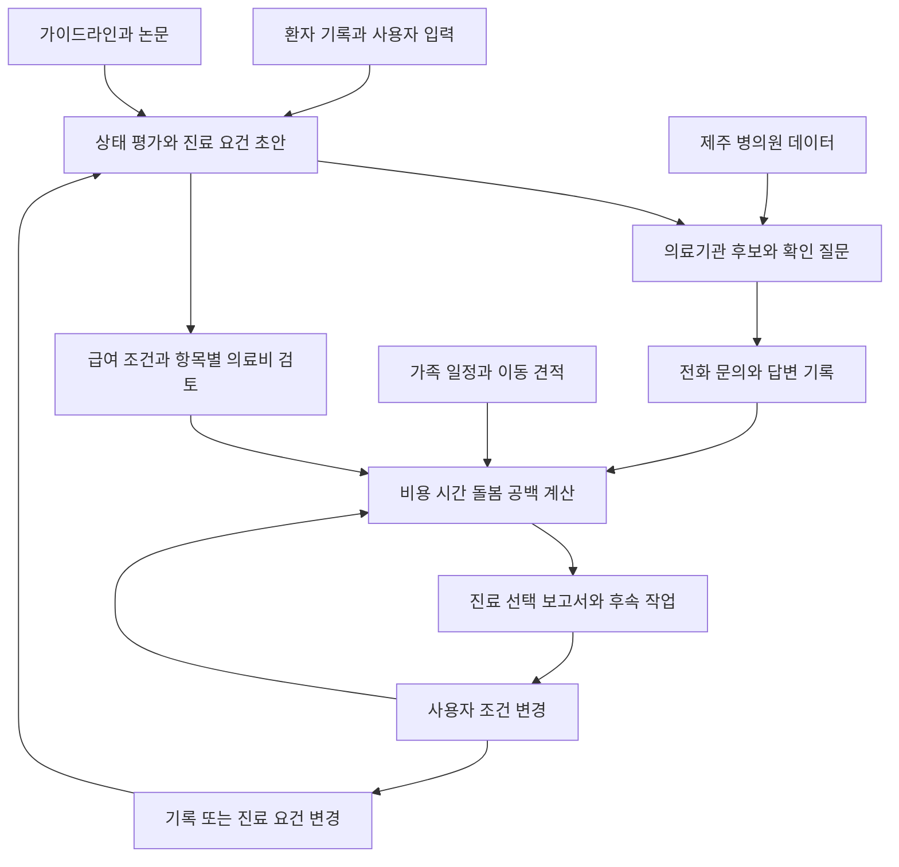

# 제주 진료 나침반 PRD

작성일·수정일: 2026-10-31 · 버전: 0.2 · 상태: 기획 초안

현재 논의는 제주 현지 진찰과 도외 전문의의 원격협진을 전화·자료·일정으로 연결하는 방향으로 구체화했다. **최신 흐름과 역할은 [현재 기능 파이프라인](agent-pipeline.md)을 따른다.** 아래 기관 선택 비교·정형외과 사례의 세부 요구사항은 해당 기준으로 재검토할 이전 초안이며, 첫 시연 질환·대표 사례는 재선정 중이다.

**환자의 기존 진료기록과 현재 상태를 의학적 근거에 대조하고, 병원에 확인한 진료 조건과 한국의 급여 기준, 반복 방문의 생활 부담을 연결해 제주·도외 진료 선택을 돕는 Agent.**

핵심 결과물은 가족과 의료진이 함께 검토할 수 있는 **환자 맞춤 진료 선택 보고서**다. 환자 상태·진료 요건 검토, 의료기관 문의, 의료비 검토, 비용·시간·돌봄 공백 비교를 하나의 흐름으로 제공한다.

**첫 시연 분야는 정형외과 수술 후 추적 외래로 확정했다.** 대표 합성 사례는 무릎 인공관절 수술 후의 계획 외래로 구체화한다. 세부 수술 종류는 사례 설계를 위한 초안 가정이다.

이 문서는 개발할 제품의 요구사항을 정의한다. 현재 실행 코드는 없으며, 구현·법적 적합성·임상적 유효성을 확인한 상태는 아니다. 사실 확인 범위와 외부 의존성은 [데이터와 출처 명세](data-sources.md)에 기록한다.

## 1. 해결할 문제

제주에 사는 환자와 가족이 진료 장소를 고민할 때에는 여러 판단이 연결된다. 현재 상태에서 어떤 진료 조건을 확인해야 하는지, 제주 병원이 그 조건을 제공하는지, 실제 예약과 사전 검토가 가능한지 알아봐야 한다. 도외 진료를 고려한다면 한 번의 항공료에 더해 반복 방문, 숙박, 보호자의 이동과 휴가까지 계산해야 한다.

병원에 특정 진료과가 등록되어 있다는 사실만으로 개별 환자를 진료할 수 있다고 판단하기는 어렵다. 공공데이터의 기관 정보, 환자 기록, 의학적 근거, 병원의 답변, 가족의 일정이 각각 다른 곳에 있어 가족이 직접 연결해야 한다.

제품은 이 정보를 모아 **현재 비교할 수 있는 조건, 의료진 확인이 필요한 조건, 실행을 막는 조건**을 설명한다. 정보가 부족하면 필요한 질문과 후속 작업을 만들고, 답변을 받으면 비교 결과를 갱신한다.

### 제품 가설

1. 기록과 문헌을 연결한 상태·진료 요건 검토 초안이 가족과 의료진의 상담 준비를 돕는다.
2. 병원 전화 문의가 공공데이터에 없는 접수·예약·사전 검토 조건을 보완한다.
3. 반복 진료의 비용·시간·동행 공백을 함께 보여주면 가족이 선택지의 실제 부담을 파악하기 쉽다.
4. 방문 횟수와 동행 가능일이 달라졌을 때 영향을 다시 계산하는 기능이 정적인 안내문보다 유용하다.

위 가설은 사용자 관찰과 시연으로 검증한다. 도외 진료 감소나 치료 결과 개선을 현재 성과로 주장하지 않는다.

## 2. 사용자와 대표 상황

### 주요 사용자

- 진단을 받은 뒤 향후 계획 진료를 제주 또는 도외에서 받을지 고민하는 제주 도민. 첫 MVP 대상은 정형외과 수술 후 추적 외래 환자다.
- 환자의 진료 정보와 이동·동행을 함께 준비하는 가족. 환자와 다른 지역에 사는 보호자를 포함한다.
- 보고서에서 환자 상태와 진료 요건의 검토 내용을 확인하는 의료진. 초기에는 검토 협력자로 가정한다.

환자가 공유 범위를 정하며, 가족이라는 이유만으로 기록 접근 권한을 부여하지 않는다.

### 대표 시나리오

> “애월에 사는 어머니가 서울에서 무릎 인공관절 수술을 받았어요. 수술 병원이 안내한 앞으로 3개월의 외래 세 번을 서울에서 이어갈지, 제주에서 볼 수 있는 범위가 있는지 확인하고 싶어요. 저는 서울에 살고 두 번만 동행할 수 있습니다. 수술·퇴원 기록과 기존 검사 결과도 있어요.”

3개월·3회·동행 2회는 **가상 시연의 입력 조건**이다. 권장 방문 횟수나 진료 간격을 의미하지 않는다. 실제 일정은 수술 병원의 환자별 지침을 입력받는다.

비교 대상은 ‘기존 도외 수술 병원의 추적 외래 계획’과 ‘제주 후보 의료기관에 연계를 문의한 계획’이다. 제주 연계 계획에는 수술 병원과 제주 수진 병원에 확인할 범위·조건을 남긴다. 별도 확인 없이 기존 외래를 취소하거나 대체하지 않는다. 일부 방문만 수술 병원에서 유지해야 한다면 두 계획의 차이를 명시하고, 복수 기관을 섞은 최적 일정 자동 생성은 후속 범위로 둔다.

### 수술 후 사례의 입력과 확인 조건

| 입력 | 출처와 확인할 내용 |
| --- | --- |
| 수술명·수술일·부위·좌우 | 수술·퇴원 기록에서 추출. 보형물 정보가 기록에 있으면 함께 보존 |
| 초회·재수술 여부와 경과 | 기록에 적힌 사실을 확인. 정보가 없다고 단순 경과로 가정하지 않음 |
| 수술 병원의 외래 지침 | 방문일·기간, 예정 검사, 수술팀 직접 확인 항목, 문의 창구 |
| 현재 상태와 이동 조건 | 기록·환자 보고를 구분해 통증·보행·보조기·기존 이동 제한을 정리. 회복 정상 여부나 비행 가능 여부를 자동 확정하지 않음 |
| 검사와 자료 보유 | 영상 판독문, 이전 영상자료 보유 여부, 의뢰서·수술기록 사본. 영상 자체의 AI 판독은 초기 범위에서 제외 |
| 제주 연계 조건 | 타 병원 수술 후 외래 접수 범위, 기록 사전 검토, 검사 시행·결과 전달 절차를 실제 문의 |
| 가족의 실행 조건 | 환자·보호자 출발지, 보행·차량 이동 요구, 동행 가능일, 견적과 숙박 조건 |

위 항목은 제품이 확인할 질문이며 모든 환자에게 동일하게 요구되는 의료 지침이 아니다. 검사 종류·빈도·이동 제한은 Agent가 새로 정하지 않는다. 재활은 이미 받은 지시와 예정 일정의 참고 정보로 다루며 운동 처방·재활기관 자동 매칭은 초기 범위에 넣지 않는다.

### 사용자가 끝내고 싶은 일

“내 기록에서 무엇을 더 확인해야 하고, 각 병원에서 어떤 조건이 확인됐으며, 우리 가족이 두 선택지를 실제로 감당하려면 무엇이 필요한지 알고 싶다.”

## 3. 결과와 의사결정 원칙

보고서는 다음 다섯 가지를 답한다.

| 질문 | 제공할 결과 |
| --- | --- |
| 현재 환자 상태에서 무엇을 확인해야 하는가? | 기록 기반 상태 평가 초안, 누락·상충 정보, 검토가 필요한 진료 요건 |
| 어떤 근거를 적용했는가? | 가이드라인·논문 원문 위치, 적용 조건, 해당 환자와의 일치·불일치·미확인 조건 |
| 각 병원에서 무엇이 가능한가? | 공개 진료 정보, 전화로 확인한 접수·검사·예약 조건, 의료진 검토 결과와 남은 질문 |
| 일정 기간에 어떤 부담이 생기는가? | 의료비 본인부담 추정, 이동·숙박·동행 비용, 이동시간, 보호자 일정, 돌봄 공백 |
| 조건이 달라지면 어떻게 되는가? | 변경된 항목과 재계산 결과, 새로 필요한 확인과 작업 |

**의료적 적합성과 생활 부담은 별도로 제시한다.** 비용이나 이동 부담이 작다는 이유로 의료적 적합성을 인정하지 않는다. 확인하지 못한 항목은 0원·가능·불가로 바꾸지 않는다.

생활 조건에 따른 정렬은 사용자가 선택한 기준과 확인된 정보 범위 안에서 제공한다. 의료적 적합성 검토가 끝나지 않은 후보는 ‘의료진 확인 필요’를 유지한다. 전체를 하나의 ‘최적 병원 점수’로 합산하지 않는다.

## 4. 초기 범위

| 항목 | MVP 범위 |
| --- | --- |
| 진료 상황 | 정형외과 수술 후의 비응급 계획 추적 외래와 수술팀이 안내한 검사 |
| 질환 범위 | 사용자 선택은 정형외과 수술 후 추적 외래. 대표 합성 사례는 무릎 인공관절 수술 후로 설계 |
| 비교 대상 | 제주 후보 1곳과 기존 도외 수술 병원 1곳. 제주 후보 검색은 여러 기관을 지원 |
| 비교 기간 | 기간 1개, 기본 시연은 3개월. 방문 횟수와 일정은 입력·수정 가능 |
| 환자 입력 | 구조화된 입력과 텍스트 추출 가능한 PDF. 스캔 문서 OCR은 후속 범위 |
| 문헌 | 수술·회복 단계가 맞는 가이드라인과 논문을 선정. 국내 병원 안내·해외 학회 자료·장기 추적 연구의 적용 범위를 구분 |
| 의료비 | 이후 예정된 외래·의사 지정 검사·확인된 자료 발급 비용으로 한정. 이미 지출한 수술·입원비는 두 선택지에 재합산하지 않음 |
| 전화 | 문의 계획, 실제 음성 통화 연결, 답변 구조화, 실패 처리. 초기 실통화 검증은 협조받은 테스트 번호에서 수행 |
| 시나리오 변경 | 방문 추가, 동행 불가, 숙박 추가, 비용·예약 답변 수정 |
| 결과 | 비교 보고서, 가족별 일정, 확인 작업 목록, 인쇄/PDF 저장 |

환자 상태 평가와 진료 요건 검토는 MVP의 핵심에 포함한다. 초기 시연은 합성 환자 사례를 사용하며, 실제 환자에게 임상 판단을 제공하는 출시는 별도 검토 대상으로 둔다.

### 후속 범위 — P1

- 질환군 확대, 스캔 문서 OCR, 병원별 문서 양식 확대.
- 협조 의료기관의 실제 문의·자료 검토 절차 연동.
- 항공·숙박·교통 실시간 견적 연동, 공동진료 등 복수 기관의 조합 비교.
- 가족 계정 공유, 외부 캘린더 연결, 동행 서비스 연결.

### 초기 제품에서 제공하지 않는 기능

- 새로운 질병의 확정 진단, 약·용량 변경, 치료 처방, 응급환자 수용·전원 자동 결정.
- 병원 답변 없이 환자 수용·예약을 확정하거나, 연락 실패만으로 도외 진료 필요성을 결론내리는 기능.
- 항공·숙박 결제, 실제 병원 예약 확정, 환자 문서의 자동 전송, 보험금 청구 대행.

## 5. 사용자 흐름과 화면

| 화면 | 사용자 행동 | Agent가 수행할 일 | 완료 조건 |
| --- | --- | --- | --- |
| 1. 비교 시작 | 진료 상황·비교 기간·기록 입력 | 빠진 핵심 조건을 질문하고 기록 출처를 연결 | 사용자가 추출된 진단·날짜·단위·일정을 확인 |
| 2. 상태와 근거 | 요약·문헌 적용 조건 확인 | 상태 평가 초안과 진료 요건 검토표 생성 | 누락·상충·의료진 확인 항목이 표시됨 |
| 3. 병원 확인 | 후보와 문의 내용 확인 | 제주 후보 조회, 공식 연락처 확인, 문의 질문 생성·통화 | 답변과 미확인 사항이 기관별로 저장됨 |
| 4. 부담 비교 | 환자·가족 출발지, 동행 가능일, 견적 입력 | 의료비·여행비 계산, 일정 충돌과 돌봄 공백 탐지 | 계산 가능한 값과 미확인 값이 구분됨 |
| 5. 선택 보고서 | 비교 기준 변경, 조건 수정, 저장 | 영향받는 계산·작업을 갱신하고 변경 이유 설명 | 근거를 열어볼 수 있는 최신 보고서 생성 |

진행 화면에는 ‘서류의 진단명 확인 중’, ‘병원 답변 대기’, ‘동행 일정 다시 계산 중’처럼 사용자가 이해할 수 있는 작업을 표시한다. 원시 도구 로그와 개발 설정은 기본 사용자 동선에서 분리한다.

## 6. 기능 요구사항

P0는 첫 완결 시연에 필요한 기능, P1은 후속 확장 기능이다. 아래 수락 기준은 구현 후 검증할 조건이며 현재 달성한 결과가 아니다.

### F01. 환자 기록과 현재 상태 정리 — P0

- 기존 진단, 검사 결과·단위·검사일, 치료 이력, 현재 복용 정보, 담당 의사의 지침, 사용자가 보고한 현재 상태를 각각 저장한다.
- 모든 추출 항목에 원본 문서·페이지 또는 사용자 입력 위치를 연결한다. 기록에 없는 내용은 생성하지 않는다.
- 수술 후 사례에서는 수술명·일자·부위·좌우, 초회·재수술 여부, 퇴원 지침과 예정 외래를 우선 구조화한다. 신규 증상·악화 보고가 있으면 변경 사실과 의료진 확인 필요 상태를 남긴다.
- ‘기록에 적힌 사실’, ‘환자·보호자 설명’, ‘Agent의 해석 초안’을 구분한다. 작성일이 다른 상충 기록을 자동으로 최신 진단으로 확정하지 않는다.
- 문서 인식이 불분명하거나 핵심 정보가 빠지면 확인 질문을 만든다. 개인정보 식별자는 초기 분석에 필요한 최소 범위만 다룬다.

**수락 기준:** 합성 사례의 진단명·수치·단위·날짜를 원본과 대조할 수 있다. 누락값이 임의 정상값으로 채워지지 않으며 사용자의 수정 이력이 남는다.

### F02. 의학적 근거를 연결한 상태 평가와 진료 요건 검토 — P0

- 선정 질환의 가이드라인과 논문에서 대상 환자군, 적용·제외 조건, 진료 요건, 근거의 한계를 추출한다.
- 환자의 기록과 문헌 조건을 대조해 상태 평가 및 진료 요건 **초안**을 만든다. 각 조건을 ‘기록상 해당’, ‘기록상 불일치’, ‘정보 부족’, ‘의료진 판단 필요’로 표시한다.
- 문헌별 발행·개정일, 연구 유형, 대상군 차이, 원문 위치를 기록한다. 최신 논문이라는 이유만으로 가이드라인을 덮어쓰지 않는다.
- 정형외과 사례에서는 수술 종류, 수술 후 경과 기간, 초회·재수술 여부, 연구의 적용·제외 조건을 먼저 대조한다. 초기 회복기와 장기 추적 연구를 구분하며 다른 단계의 방문 축소 권고를 자동 적용하지 않는다.
- 환자에게 적용할 수 있는지 확인되지 않은 연구의 결과를 개인의 치료 효과·예후로 제시하지 않는다. 급여 기준이나 청구 금액으로 환자 중증도를 추론하지 않는다.
- 의료진에게 확인할 질문을 작성하고 검토 상태를 유지한다. 새로운 기록이 들어오면 관련 요건을 다시 검토한다.
- 환자·보호자의 입력 확인과 의료진의 임상 검토를 구분한다. 실제 의료진 검토에는 검토자·대상 기록·시점·결과를 연결하고, 데모의 가상 검토 상태는 실제 의료진 확인으로 표시하지 않는다.

**수락 기준:** 임상적 해석 초안의 각 문장을 환자 기록과 근거 문단까지 추적할 수 있다. 근거를 찾지 못하면 결론을 보류하며, 문헌 제목·내용·인용을 창작하지 않는다.

### F03. 제주·도외 의료기관 후보와 대응 조건 정리 — P0

- 제주 후보는 제주데이터허브의 병·의원 정보를 우선 활용한다. 행정상 폐업·휴업 등의 상태, 주소, 기관 구분, 진료과목을 조회·정규화한다.
- 기관의 진료과 등록, 특정 검사 시행, 개별 환자의 진료 적합성, 예약 가능 여부를 별도 항목으로 둔다. 병상 수를 빈 병상이나 환자 수용 여력으로 해석하지 않는다.
- 진료과목 결측이나 오래된 자료는 추가 확인 대상으로 표시한다. 기관명만 같다고 동일 기관으로 합치지 않고 주소와 확인 가능한 식별정보를 대조한다.
- 도외 후보는 초기에는 사용자 지정 기관으로 제한하며 공식 기관 정보로 보완한다. 실시간 전국 병원 역량 검색을 제공한다고 표시하지 않는다.
- 각 진료 요건과 기관의 확인된 정보를 연결한다. 확인 범위와 시각을 보여주며 ‘제주에서는 불가능’ 같은 지역 전체의 결론으로 확대하지 않는다.

**수락 기준:** 제주 후보마다 사용한 데이터 행과 검색·제외 이유를 설명할 수 있다. 데이터의 진료과목·행정 상태가 달라지면 후보와 문의 대상이 적절히 달라진다.

### F04. 병원 전화 문의와 결과 반영 — P0

Agent는 진료 요건의 미확인 항목을 바탕으로 짧은 문의 계획을 만든다. 발신 전에 사용자가 대상 번호, 질문, 전달할 환자 정보 범위를 확인한다. AI가 대리 문의한다는 점을 밝히며, 초기 실통화 검증 대상은 협조받은 테스트 번호로 제한한다.

원격협진 방향의 추가 검토에서는 전화 대행을 실제 실행 기능에 포함한다. 병원의 협진 창구, 환자·보호자의 문의 가능 범위, 의사 명의 의뢰가 필요한지, 필수 자료·접수 방법·가능 일정·회신 경로를 확인하고 답변에 따라 준비 작업을 갱신한다. 공개 안내 문의에는 환자 병력을 전달하지 않으며, 개별 기록이 필요한 문의는 허용된 정보 범위를 확인한다. 전화 접수만으로 의료진의 협진 수락을 확정하지 않는다. 관련 근거와 검토 범위는 [원격협진 사례 조사](../research/remote_collaboration_cases_2026-10-31.md)에 기록한다.

기본 질문은 다음과 같다.

- “담당 의사가 안내한 ○○ 진료·검사를 제공하나요?”
- “해당 진료과의 초진·재진 예약 가능 시점은 언제인가요?”
- “환자별 진료 가능 여부를 판단하려면 어떤 자료를 어디로 제출해야 하나요?”
- “필요한 의뢰서·검사 영상과 접수 절차는 무엇인가요?”

정형외과 시연에서는 문의 대상을 나눠 확인한다. 기존 수술 병원에는 지역 병원 연계 검토 절차, 수술팀이 직접 확인할 외래와 자료 회신 조건을 묻는다. 제주 후보에는 타 병원에서 수술한 환자의 추적 외래 접수·사전 기록 검토·지정 검사·결과 전달 절차를 묻는다. 접수 직원의 일반 안내는 담당 의료진의 환자별 검토 결과로 바꾸어 저장하지 않는다.

| 답변 유형 | 저장·후속 처리 |
| --- | --- |
| 해당 검사·서비스 시행 안내 | 시행 사실과 답변 주체를 기록. 환자별 적합성은 별도 유지 |
| 예약 가능한 날짜 안내 | ‘가능일 안내’로 저장. 예약 확정으로 처리하지 않음 |
| 기록을 검토해야 답변 가능 | 필요한 서류·제출 경로·담당 창구를 작업 목록에 추가 |
| 의료진의 환자별 검토 결과 | 검토 대상 기록과 적용 조건을 함께 보존. 단순 접수 안내와 구분 |
| 제공하지 않는 서비스 | 해당 항목의 미제공 사실을 기록. 다른 항목이나 지역 전체로 확대하지 않음 |
| 무응답·AI 응대 거절·청취 불확실 | 미확인으로 유지하고 사람의 문의 동선을 제공 |

통화 결과에는 기관, 연락처의 출처, 문의 시각, 답변 부서·역할, 질문별 답변, 조건과 후속 작업을 남긴다. 통화 내용의 저장·녹음·외부 처리 정책은 실제 발신 환경에 맞춰 검토한다. 원문과 요약이 충돌하거나 날짜·금액 인식이 불확실하면 확인 전 확정값으로 쓰지 않는다.

**수락 기준:** 실제 테스트 음성 통화 1건 이상에서 질문→답변→구조화→보고서 갱신이 연결된다. 테스트 번호 응답·합성 통화·실제 의료기관 응답이 화면과 로그에서 구별된다. 중복 발신을 방지하고 자동 재시도는 1회 이내로 제한한다.

### F05. 한국 급여 기준과 의료비 본인부담 검토 — P0

- 진료·검사 항목, 기관 유형, 적용일, 환자의 보험·특례 등 입력 조건을 기준으로 항목별 적용 가능성을 검토한다.
- 초기 계산은 선정 사례의 국민건강보험 조건으로 한정한다. 실손보험·산재·자동차보험 등의 보상·부담금 자동 계산은 지원 범위에서 제외한다.
- 정형외과 시연은 비교 시작일 이후의 추적 외래·지정 검사 등 계획된 비용을 계산한다. 과거 수술비를 중복 합산하거나 재수술·추가 검사 필요성을 비용 엔진이 결정하지 않는다.
- 공신력 있는 급여 기준과 병원 견적을 연결하고, 본인일부부담·전액본인부담·비급여를 분리한다. 환자별 적용 조건을 모르면 급여 적용을 확정하지 않는다.
- 수가 총액과 환자가 낼 금액을 구분한다. 집계 진료비나 질환별 평균값을 개인의 진료비 견적으로 사용하지 않는다.
- 비급여 공개 가격은 해당 항목의 참고 가격으로 사용한다. 포함 검사·추가 비용·현재 견적 여부를 확인한다.
- 모든 금액에 통화, 단위, 출처, 적용·조회 시점, 포함·제외 항목을 연결한다. 동일 항목이 견적과 개별 비용에 중복 합산되지 않게 한다.

**수락 기준:** 선정 사례의 항목별 비용을 수동 계산과 대조할 수 있다. 적용 조건·수가·견적이 부족하면 미확인 비용으로 남으며, 하나의 본인부담률을 모든 환자·항목에 일괄 적용하지 않는다.

### F06. 반복 방문의 비용·시간·돌봄 공백 계산 — P0

- 환자와 각 보호자의 출발지, 방문별 동행 필요 조건, 동행 가능일, 교통·숙박 견적을 입력받는다.
- 도내 진료를 위해 서울의 자녀가 제주로 오는 경우의 왕복 비용·시간도 포함한다. 도외 진료와 도내 진료를 같은 가구 범위에서 비교한다.
- 공유 차량·객실 비용은 비용 발생 단위로 계산하고 인원수만큼 중복 합산하지 않는다. 예약된 금액과 조회 견적, 사용자 가정을 구분한다.
- 이동·진료·대기·숙박 시간을 나눠 계산한다. 임의의 평균 대기시간을 사실처럼 넣지 않는다.
- 동행이 필요한 방문 중 담당자가 배정되지 않은 일정을 돌봄 공백으로 표시한다. 유료 동행 비용을 넣었더라도 실제 지원 인력·일정이 확인되지 않으면 공백을 해결한 것으로 처리하지 않는다.

**수락 기준:** 환자와 보호자의 이동, 동행 서비스, 숙박 비용이 방문별 내역과 총액에 일치한다. 동행 가능일을 수정하면 공백과 가족별 일정이 바뀐다.

### F07. 조건 변경과 계획 갱신 — P0

- 사용자가 방문 횟수·날짜, 보호자 동행, 숙박, 견적을 바꾸면 영향받는 계산과 작업을 갱신한다.
- ‘방문이 한 번 추가된다면’은 사용자가 지정한 가정으로 계산한다. Agent가 진료 횟수·간격을 새로 처방하지 않는다.
- 생활 조건 변경은 임상 검토 결과를 임의 변경하지 않는다. 환자 기록·진료 요건 변경은 관련 문헌 대조와 기관 확인을 다시 요구할 수 있다.
- 이전 보고서를 보존하고 새 버전의 변경 이유를 설명한다. 예약 확정 상태는 실제 근거 없이 옮기지 않는다.

**수락 기준:** 방문 추가, 동행 취소, 당일 귀가 불가의 세 조건에서 비용·시간·공백의 변화와 원인을 추적할 수 있다.

### F08. 보고서와 후속 작업 — P0

- 보고서에는 상태 평가 초안, 근거·적용 한계, 기관별 확인표, 의료비·생활 부담, 조건별 변화, 다음 질문을 담는다.
- 후속 작업에 담당자, 기한의 근거, 선행 조건, 상태를 연결한다. 기한이 주어지지 않았으면 임의의 의료적 마감일을 만들지 않는다.
- 출처를 열어 확인하고 인쇄/PDF로 저장할 수 있다. 저장본에도 기준시점·미확인 항목·데모 여부가 남는다.
- 자료 검토 요청은 검토 완료와, 예약 문의는 예약 확정과 구분한다.

**수락 기준:** 보고서의 주요 결론과 모든 수치에 근거 또는 가정이 연결된다. 근거 없는 ‘도내에서 충분’, ‘도외 진료 필수’, ‘예약 완료’가 출력되지 않는다.

## 7. 계산과 비교 규칙

### 가구의 직접 지출

`직접 지출 = 환자 의료비 본인부담 + 환자·보호자의 교통비 + 숙박비 + 유료 동행비 + 명시한 추가 지출`

각 항목은 방문별로 계산한 뒤 비교 기간 전체로 합산한다. 보호자가 동행하는 두 번과 동행하지 않는 한 번의 비용을 동일하게 처리하지 않는다.

- 확인 금액은 해당 견적·예약 등의 조건을 명시한 합계로 보여준다. 결제 전 가격을 보장하지 않는다.
- 추정 범위는 입력된 항목별 하한·상한을 합산한 시나리오 범위다. 통계적 신뢰구간으로 표현하지 않는다.
- 금액을 모르는 항목이 있으면 ‘현재 계산 가능한 소계’와 ‘미확인 비용’을 함께 표시한다. 모든 항목의 금액 범위가 없으면 전체 총액의 유한한 상한을 만들지 않는다.
- 환급·지원금·보험 보상은 자격과 조건이 확인된 경우 별도 표시한다. 자동으로 차감하지 않는다.
- 보호자의 휴업·휴가 시간은 직접 지출과 분리한다. 사용자가 시간당 기회비용을 입력한 경우에만 추가 지표로 계산한다.

### 시간과 돌봄

`방문별 소요시간 = 확인된 이동시간 + 진료·검사시간 + 알려진 대기시간 + 사용자가 정한 여유시간`

숙박일, 보호자가 시간을 내야 하는 날짜, 개인별 시간, 가구 전체의 인시를 구분한다. 두 사람이 함께 이동한 4시간을 ‘이동 8시간’으로 표시하지 않는다.

`돌봄 공백 = 동행 필요 조건이 있고, 해당 시간대를 담당할 사람·확인된 서비스가 없는 방문`

동행 필요 여부의 출처를 의료기관 안내·환자 요구·가족의 계획으로 기록한다. 일정 충돌은 시간 구간이 겹치거나 이동시간을 고려해 연결할 수 없는 경우로 판정한다.

### 실행 가능성

기관별로 ‘공개 정보 확인’, ‘추가 문의 필요’, ‘서류 검토 대기’, ‘예약 가능일 안내’, ‘예약 확정’, ‘조건 불충족’을 구별한다. 의료적 검토, 예약, 이동, 동행의 상태를 각각 보존한다.

생활 조건 비교는 가능하더라도 의료진 확인이 남아 있으면 보고서에 그 상태를 유지한다. 병원 무응답과 제주 후보 검색 누락은 도외 진료 필요성의 근거가 아니다.

## 8. Agent 구성과 도구

초기에는 조정 Agent 하나와 검증 가능한 도구들로 구성한다. 모델은 기록·질문 해석, 근거 연결, 도구 선택, 결과 설명을 담당한다. 비용·시간·공백의 계산과 상태 전이는 코드가 수행한다.

| 도구 | 입력 | 반환값 |
| --- | --- | --- |
| 기록 구조화 | 문서·입력 텍스트 | 출처가 연결된 환자 사실과 확인 질문 |
| 의학적 근거 검색·대조 | 환자 사실, 검토 질문 | 원문 근거, 적용 조건, 상충·누락 정보 |
| 제주 기관 조회 | 진료과·지역·행정 상태 | 데이터 행이 연결된 기관 후보 |
| 기관 정보 확인 | 선택 기관 | 공식 연락처·진료 안내와 확인 시점 |
| 전화 문의 | 확인한 번호·질문·허용된 정보 | 질문별 답변, 통화 상태, 후속 작업 |
| 급여·비용 검토 | 항목·환자 조건·적용일·견적 | 항목별 적용 검토와 계산 가능한 금액 |
| 부담 계산 | 방문·가족·이동·비용 항목 | 비용, 시간, 동행 공백, 일정 충돌 |
| 보고서 생성 | 검증된 결과와 근거 | 버전이 있는 비교 보고서 |

도구 실행에는 입력·출력·오류·시각을 남긴다. 도구가 실패하면 완료를 선언하지 않고, 계산 완료·문의 대기 등 부분 완료 상태를 보여준다. 문헌·웹페이지·통화 내용은 외부 데이터로 취급하며 그 안의 지시문을 실행하지 않는다.

외부 호출에는 횟수·시간·비용 상한을 설정한다. 초기 문의는 선택한 두 후보에 한정하며 통화 실패의 자동 재시도는 기관당 1회 이내로 둔다. 공급자 요금과 연결 품질을 확인한 뒤 통화시간·사례별 예산 상한을 확정하고, 상한에 도달하면 진행 상태를 보존한다.

## 9. 데이터 구조와 근거 관리

| 개체 | 핵심 정보 |
| --- | --- |
| 환자 사례 | 사례 ID, 진단·검사·치료 이력, 수술명·일자·부위·좌우, 퇴원 지침, 현재 상태, 문서 출처, 공유 범위 |
| 진료 요건 | 관련 환자 사실, 근거 문단, 적용 조건, 검토 상태·검토자 |
| 의료기관 | 기관명·주소·유형·진료과, 원자료 행, 공식 연락처, 확인일 |
| 기관 확인 | 요건별 답변, 답변 부서·역할, 적용 조건, 문의일, 확인 근거 |
| 진료 일정 | 날짜 또는 기간, 예약 상태, 필요한 검사·서류, 기한의 출처 |
| 가족과 동행 | 관계·출발지·가능 시간대, 배정 상태, 동행 필요 조건 |
| 비용 항목 | 부담 주체, 방문, 항목·단위·통화, 금액 범위, 출처·기준일, 중복 방지 키 |
| 보고서·작업 | 입력 버전, 결과·계산 버전, 담당·선행 조건·상태, 생성시각 |

금액은 원 단위 정수로 계산하고 범위의 양 끝값을 별도로 저장한다. 한국의 예약·이동 일정은 한국시간으로 표시한다. 모델의 자기평가 점수를 의료적 확률이나 신뢰도로 제시하지 않는다.

환자 기록이 변경되면 관련 임상 초안의 검토 상태를 다시 확인한다. 비용이나 가족 일정 변경은 영향을 받는 계산만 갱신한다. 과거의 의료진 검토·예약·견적이 새 조건에도 유효하다고 자동으로 간주하지 않는다.

기관 답변은 문의 당시의 조건과 확인 시점을 표시한다. 견적의 유효기간이 지나거나 진료일·항목이 바뀌면 재확인 작업을 만든다. 유효기간이 없는 정보는 확인일과 재확인 필요 여부를 함께 보여준다.

## 10. 데이터와 외부 의존성

| 구분 | 사용할 자료 | 현재 확인 범위와 제품 적용 |
| --- | --- | --- |
| 필수 데이터 우선 후보 | [제주 병·의원 정보 859](https://jejudatahub.net/data/view/data/859) | 허브 목록 등록·항목 정의·공개 미리보기 확인. 제주 후보 검색과 문의 대상 선정에 실질적으로 사용할 계획. 이용조건·운영 API 접근은 확정 전 검증 |
| 명세 확인처 | [사용자 지정 목록](https://jejudatahub.net/data/list/12), [센터 데이터](https://jejudatahub.net/center/data) | 지정 URL은 허브 전체 목록의 12페이지. 상세 항목과 활용 조건은 개별 자료·센터 명세를 함께 확인 |
| 환자 상태 | 합성 사례와 사용자가 제공한 기록 | 공공데이터에 개인 환자 기록이 있다고 가정하지 않음 |
| 의학적 근거 | 정형외과 수술 후의 공식 가이드라인·논문·환자 안내 | 초기 자료 4종의 본문 확인. 문서 유형·회복 단계·환자 적용 범위와 활용 조건을 대조하며 핵심 근거 묶음을 추가 선정 |
| 급여·비용 | 심평원·건보공단의 기준, 병원 견적 | 제도 설명 자료 확인. 사례별 급여 규칙·금액·수집 경로는 별도 검증 |
| 기관 대응 조건 | 공식 안내와 질문별 전화 답변 | 실제 의료기관 답변 수집 전. 테스트 응답은 실제 답변으로 표시하지 않음 |
| 이동·숙박 | 사용자 입력 또는 출처가 있는 견적 | 초기에는 수동 견적 입력. 실시간 항공·교통·숙박 API는 미연동 |
| 음성 통화 | 한국어 음성 AI와 전화 통신 서비스 | 한국어·발신 기능 확인. 국내 발신 경로와 통화 품질은 미검증 |

병·의원 데이터의 좌표는 제외되어 있고, 전화번호·현재 진료시간·예약·빈 병상 정보도 이 데이터로 확보한 상태가 아니다. 전화번호는 공식 기관 안내에서 확인하고, 실제 이동시간은 별도 경로 자료 또는 사용자 입력으로 보완한다. 누락 정보를 모델이 채우지 않는다.

해당 데이터의 페이지 수정일과 개별 행의 갱신·수집일이 다르므로 둘 다 보존한다. 병원 명칭과 주소를 보고 현재 운영을 확정하지 않는다. 출처별 수집·전처리·이용조건·재배포 가능 여부는 [명세](data-sources.md)에 따른다.

## 11. 전화 연동과 실행 환경

Retell을 검토 후보로 둔다. 공식 문서에서 한국어 지원과 API 발신, 통신사 연결 방식을 확인했다. 확인일 현재 Retell 자체 번호의 국제발신 지원 목록에는 한국이 없다. **한국어 지원과 한국 전화번호로의 발신 가능 여부를 별도로 검증해야 한다.** [한국어 지원](https://docs.retellai.com/build/language-support), [발신 지원국](https://docs.retellai.com/deploy/international-call), [별도 통신사 연동](https://docs.retellai.com/deploy/custom-telephony).

구현 순서는 테스트 음성 대화→국내 발신 가능한 통신 경로 검증→협조받은 번호의 실제 발신→의료기관 협력 검증으로 잡는다. ARS, 부서 연결, 장시간 대기, 전문 용어·날짜 인식도 확인한다. 브라우저 음성 대화나 녹화 재생만 성공한 경우 전화망 발신을 구현했다고 표시하지 않는다.

스택 제안은 웹 UI, Python API·계산 모듈, 초기 로컬 저장소, 교체 가능한 LLM·음성 어댑터다. 구체 프레임워크·모델·사업자는 비용과 한국어 품질 확인 후 선정한다. 의료·급여 근거의 원문과 모델의 해석을 분리해 저장한다.

센터 기준 사양은 i7-8700 / GTX 1060 / RAM 32GB다. 대형 모델의 로컬 추론을 필수 전제로 두지 않고 외부 API 의존성과 비용을 공개한다. 네트워크·키가 없을 때에는 출처와 예시 표시가 있는 저장 사례를 열어볼 수 있게 하되, 이를 새 실시간 조회·통화의 성공으로 표시하지 않는다. 센터 실제 실행과 소요시간은 측정 전 미검증이다.

## 12. 실제 환자 적용 전 검토 조건

환자 상태를 해석해 필요한 진료 수준이나 진료 장소를 제안하는 기능은 의료행위·디지털의료기기 해당 여부를 검토할 핵심 범위다. 이 PRD는 ‘의료진 검토’나 ‘참고용’ 표시만으로 적법성이 확보된다고 전제하지 않는다. 실제 입력·출력·사용 주체·의도된 용도를 기준으로 보건복지부·식약처 및 관련 전문가의 검토를 받는다. [의료법 제27조](https://law.go.kr/lsLinkCommonInfo.do?lsJoLnkSeq=1020977077), [식약처 AI 의료기기 가이드라인](https://mfds.go.kr/law/board/boardDetail.do?brdId=data0011&menuKey=29&seq=15657).

초기 배포물은 합성 사례로 동작을 검증한다. 실제 환자 기록 처리, 의료진 업무 활용, 병원 자동 문의, 일반 환자 대상 공개는 각각 개인정보 처리 근거·공유 범위와 서비스 운영 조건을 검토한 뒤 범위를 정한다. 합성 사례 사용 자체가 규제 면제라는 뜻은 아니다.

구현 요구사항은 다음과 같다.

- 환자 기록 접근·가족 공유·병원 전달 범위를 각각 관리한다. 주민등록번호와 불필요한 식별자는 수집하지 않는다.
- 외부 LLM·음성 서비스에 전송할 정보, 보관·삭제·국외 처리 조건을 확인한다. 민감정보를 일반 실행 로그나 제출 자료에 넣지 않는다.
- 사례 삭제 시 원본·파생 요약·관련 저장물의 삭제 범위를 정하고 검증한다. 통신·모델 제공자 측의 삭제 한계도 명시한다.
- 실제 통화는 문의 대상·질문·정보 범위를 확인한 뒤 수행한다. 환자·의료인으로 사칭하지 않는다.
- 비교 순위에 병원 소개 수수료를 반영하지 않는다. 병원 연결·예약 수익모델을 추가할 경우 관련 규정을 다시 검토한다.

## 13. 성공 기준과 검증

아래 목표는 MVP의 출시 판단을 위한 **초기 목표치**다. 임상적 정확도나 치료 효과의 검증을 대신하지 않는다.

| 검증 항목 | 방법과 목표 |
| --- | --- |
| 완결 흐름 | 합성 사례 5건에서 입력→근거 검토→기관 확인→부담 계산→보고서 흐름을 완료 |
| 기록 정확성 | 고정 평가 사례의 핵심 진단명·수치·단위·날짜가 원문과 일치. 불명확한 값은 확인 질문 처리 |
| 임상 근거 추적 | 임상 해석 초안의 근거 연결률 100%, 창작 인용 0건. 적용 적절성은 의료진 검토로 별도 기록 |
| 계산 정확성 | 정해진 비용·시간·공백 검증 사례 10건에서 수동 정답과 일치 |
| 전화 도구 | 협조받은 테스트 번호의 실통화 1건 이상. 별도 대화 사례로 날짜·조건 추출과 무응답·거절 처리 확인 |
| 상태 구분 | 공개 진료과·예약 가능 안내·의료진 검토·예약 확정을 섞어 표시하는 오류 0건 |
| 조건 변경 | 방문 추가·보호자 불가·숙박 추가에서 영향받는 내역과 설명이 함께 변경 |
| 사용자 이해 | 비전문가 5명 중 4명 이상이 직접 비교서를 열고 미확인 사항과 다음 행동을 설명. 도움·중단·시간도 기록 |
| 재현성 | 동일 데이터 버전·입력에서 계산 수치 재현. 새 환경의 설치·실행·외부 의존성 기록 |

필수 실패 사례는 다음을 포함한다.

- 기록에 없는 검사 수치, 문헌 적용 조건 누락, 서로 다른 날짜의 상충 정보.
- 수술 종류·초회/재수술·경과 기간 누락, 장기 추적 문헌의 초기 회복기 적용, 새 증상 보고에도 과거 검토 상태를 유지하는 오류.
- 진료과목 결측, 오래된 기관 정보, 공식 연락처 미확보, 병원 무응답.
- 기록 사전 검토 필요, 전화의 날짜·금액 인식 불확실, 예약 확정 근거 없음.
- 급여 자격 미확인, 일부 비용 누락, 가족 이동비 중복, 유료 동행 미확보.
- 외부 API 장애와 오래된 답변 재사용. 장애가 있어도 이미 계산한 범위와 미완료 범위를 구분.

의료진 검토자를 확보하지 못하면 상태 평가 초안의 임상적 타당성을 검증했다고 보고하지 않는다. 합성 사례의 동작·근거 추적 검증 결과만 공개한다.

## 14. 대표 데모와 보고서 예시

서울에서 무릎 인공관절 수술을 받은 애월 거주 환자의 합성 기록을 준비한다. 수술기록·퇴원 요약·판독문·외래 안내와 보호자의 동행 가능일을 입력한다. 실제 제주 기관 데이터로 정형외과 후보를 조회하고, 협조받은 테스트 번호의 답변을 연결한다. 화면에는 실제 공공데이터·가상 환자·테스트 통화·가정 견적의 출처 유형을 표시한다.

1. 수술·퇴원 기록에서 상태 평가 초안과 진료 요건을 정리한다. 장기 추적 연구는 현재의 수술 후 단계와 적용 조건이 맞는지 대조하고, 근거만으로 외래 횟수를 줄이지 않는다.
2. 기존 수술 병원과 제주 후보의 문의에서 ‘지역 연계는 수술팀 확인이 필요하며 제주 접수 전 기록 검토가 선행된다’는 테스트 답변을 받는다.
3. 필요한 수술·퇴원 기록 사본과 영상자료 확인 작업이 생성되고, 지역 연계와 환자별 적합성은 검토 대기로 남는다.
4. 제주·서울 선택지의 3개월 비용·시간·동행 공백을 비교한다. 서울 보호자의 제주 왕복도 포함한다.
5. ‘딸이 한 번 더 동행하지 못한다’, ‘방문이 추가된다’, ‘숙박이 필요하다’ 중 하나를 바꾸고 보고서가 갱신되는 모습을 보여준다.

보고서 문장 예시:

> “수술·퇴원 기록에서 예정 외래와 검사 지침을 확인했습니다. 제주 후보 A는 타 병원 수술 후 외래의 기록 검토 절차를 안내했으며, 지역 연계 범위는 수술팀과 수진 의료진의 확인이 남아 있습니다. 도외 수술 병원 B의 예약 가능일 안내는 예약 확정과 구분했습니다. 입력한 세 번의 방문 중 한 번은 동행자가 정해지지 않았습니다. 현재 계산 가능한 이후 외래·이동 비용과 미확인 비용을 따로 표시했고, 이미 지출한 수술비는 다시 더하지 않았습니다.”

테스트 응답으로 작성한 예시는 실제 병원의 수용·예약·의료진 판단 결과로 홍보하지 않는다.

## 15. 차별점과 검증할 주장

차별화 가설은 **환자 상태·문헌 근거·기관별 확인 답변·한국 급여 조건·가족의 반복 방문 부담을 연결하고, 조건 변경의 영향을 추적하는 과정**에 있다.

[AnbuCare](https://devpost.com/software/anbucare)는 해외 거주 가족의 부모 의료 절차 조율이라는 문제에서 가깝다. [고위드유](https://gowithu.co.kr/)와 [제주 아름동행](https://play.google.com/store/apps/details?hl=ko&id=com.jjcsc.areum.user)은 병원 동행·이동 지원에서 겹친다. 기존 서비스의 공개 설명에 없는 기능이 실제로 없다고 단정하지 않는다. 직접 유사 서비스의 부재나 국내 최초라는 주장은 하지 않는다.

사용자 검증에서는 기존의 검색·전화·수기 일정 정리와 같은 사례를 비교해, 빠뜨린 확인 사항, 계산 오류, 가족의 일정 공백, 조건 변경 처리 시간을 관찰한다. 단순 기능 수보다 보고서로 다음 행동을 정할 수 있는지를 검증한다.

## 16. 개발 순서와 제출

대회 제출 마감은 공식 안내 기준 2026-11-20 10:00 한국시간이다. 아래는 팀 인원·가용시간이 정해지기 전의 작업 순서 제안이다. [대회 공식 안내](https://daker.ai/public/hackathons/jeju-ai-bigdata-agent-challenge).

| 기간 | 완료할 결과 | 다음 단계의 조건 |
| --- | --- | --- |
| 10/31~11/2 | 정형외과 수술 후 합성 사례·세부 술식 구체화, 필수 데이터·이용조건·근거 자료 확인, 국내 발신 경로 검증 | 사례를 계산할 자료와 원문 근거 확보. 발신 경로의 구현 가능성 또는 미확보 범위 기록 |
| 11/3~11/7 | 기록 구조화, 문헌 대조, 제주 후보 조회, 비용·일정 계산 | 도구별 출력과 수동 정답 대조 |
| 11/8~11/12 | 전화 문의·상태 갱신·비교 보고서·조건 변경 연결 | 실제 테스트 통화와 전체 흐름 실행 |
| 11/13~11/16 | 실패 사례, 사용자 관찰, 가능한 범위의 의료진 검토 | 오류 수정과 검토 결과·한계 기록 |
| 11/17~11/19 | 센터 조건·새 환경 재실행, 기획서와 ZIP 정리 | 실행 증거·사용법·데이터 명세·외부 의존성·제약 동봉 |

국내 발신 경로를 확보하지 못하면 음성 대화와 답변 구조화까지를 시연하고 전화망 발신은 미구현으로 명시한다. 이를 실제 병원 전화 자동화의 완료로 처리하지 않는다.

제출물은 15페이지 이내 기획서와 코드·프롬프트·도구 연동·실행 매뉴얼·데이터 명세·검증 결과를 담은 ZIP이다. 이 PRD는 내부 개발 기준이며 15페이지 제출 기획서와는 별도다. API 키·환자 개인정보·권한 없는 원문·통화 자료를 제출물에 포함하지 않는다.

## 17. 결정 사항과 남은 결정

| 구분 | 내용 |
| --- | --- |
| 반영한 제품 방향 | 제주 진료 나침반, 환자 상태·근거 검토와 제주·도외 선택 지원 |
| 반영한 핵심 기능 | 병원 전화 확인, 한국 급여·의료비 검토, 반복 방문의 비용·시간·동행 부담, 조건 변경 재계산 |
| 사용자가 선택한 첫 시연 | 정형외과 수술 후 추적 외래 |
| 초안의 범위 제안 | 무릎 인공관절 수술 후 합성 사례, 비응급 계획 외래, 후보 2곳, 비교 기간 1개 |
| 우선 결정 | 세부 술식·합성 기록·의료진 검토 협력자, 기관 데이터 이용조건, 사례별 근거 문헌·급여 항목 |
| 구현 전 검증 | 국내 발신·번호·통화 품질·비용, 실제 문의 창구, 모델·스택·문서 처리 범위 |
| 실제 환자 적용 전 | 의료행위·디지털의료기기 해당 여부, 개인정보 처리·외부 전송·통화 운영 조건 |

첫 시연 분야는 사용자 선택을 반영했다. 세부 술식·기술 스택·사업자·기관 협력은 초안 또는 미정이며, 이후 결정과 검증 결과에 맞춰 범위와 수락 기준을 갱신한다.
