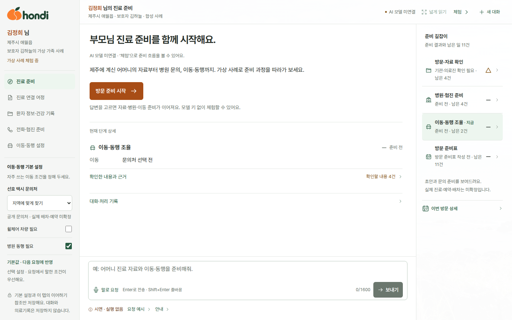
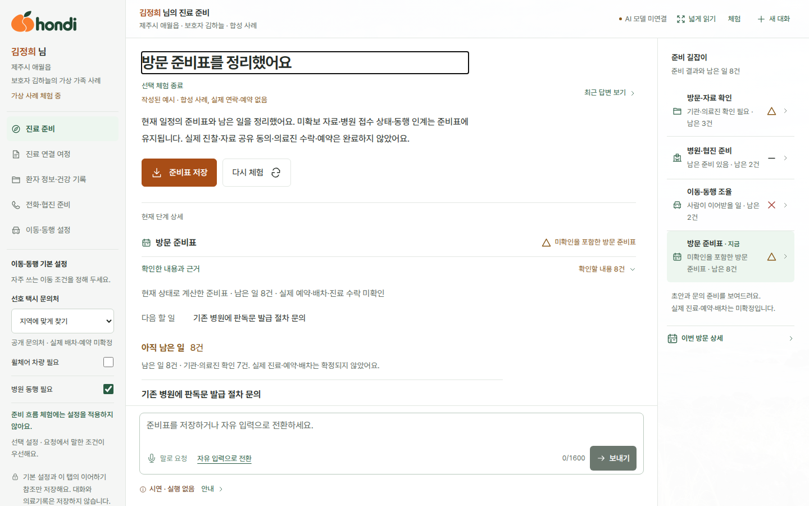
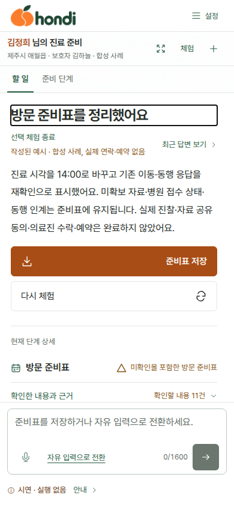

# 평가자·사용자 관점 검토와 선택형 체험

2026-11-15 · 기준선 `335fdfc1f126b062cbcbdefd8cd7f82b9fe8b30d`. 고정 선택형 합성 체험, 화면 진입·접근성, 공통 표현 함수와 제출 설명을 검토했다. 실제 전화·예약·배차는 이번 MVP 범위가 아니다.

## 발견과 수정

| 발견 | 수정 |
| --- | --- |
| 기존 체험 뒤 초안을 보내면 일반 모델 API로 넘어가 키 없는 평가자가 진행을 끝내지 못함 | 중앙 ‘방문 준비 시작’에서 네 질문을 선택. 일반 모델 POST 없이 실제 preview API·도구를 호출하고 준비표까지 연결 |
| 첫 화면에서 시작할 곳이 약함 | 현재 작업 아래 주 행동과 짧은 설명. 오른쪽은 단계 탐색, 중앙은 현재 질문·결과. 로고·색·배치 유지 |
| 종료 뒤에도 ‘다음 답변 선택’ 입력 안내 | ‘준비표를 저장하거나 자유 입력으로 전환’으로 변경 |
| `aside`의 `tabpanel` 역할이 axe에서 허용되지 않음 | 같은 탭 제어·DOM 위치를 유지한 `div role=tabpanel` 사용 |
| 같은 HTML 이스케이프 함수의 중복 | 기존 message-format 함수를 네 화면에서 재사용. 원문/링크 escaping 검사 유지 |
| 반복 글자 크기·조작 높이·곡률 값 | CSS 공통 변수로 모음. 기존 계산값·색·간격·100dvh·단일 입력 유지 |
| 제출 화면·사용법이 과거 한 번의 예시에 머무름 | 선택형 체험의 매뉴얼·PRD·기획서·대표 화면으로 갱신하고 실제 LLM 평가 조건 별도 명시 |

코드 중복이 전혀 없다고 판정하지 않는다. 확인한 동일 함수와 기본 값을 정리했고 별도 상태 머신을 복제하지 않고 기존 dispatcher·reducer·workflow·내보내기를 사용했다. 방어 검사나 기존 기능을 삭제해 줄 수만 줄이지 않았다.

## 실제 실행 범위

자료 보유/미확보, 제주 접수 안내/거절, 일반 택시/휠체어, 일정 유지/14시 변경의16개 조합을 지원한다. 서버는 선택 ID의 순서·개수·추가 인자를 검사하고 같은 의미의 합성 상태를 재생한다. 클라이언트 환자 상태나 임의 도구 실행을 받지 않는다. 공개 snapshot을 조회하며 휠체어 선택은 교통약자 문의처·질문으로 바뀐다.

미확보 자료·기관 거절·동행 인계를 보존하고, 일정 변경은 이동·동행 재확인을 만든다. 도구 실행과 체험 종료를 실제 준비 완료로 해석하지 않는다. 체험은 모델·DB·Secret·전역 budget·실발신을 사용하지 않는다. 자유 입력으로 명시 전환하면 기존 LLM 경로를 사용하며 현재 모델 품질은 미검증이다.

## 공식 평가표 대응

[대회 공식 페이지](https://daker.ai/public/hackathons/jeju-ai-bigdata-agent-challenge), 2026-11-15 렌더링 본문 확인. 전문가70%·동료30%의 실제 점수를 자체 검토로 예측하지 않는다.

| 항목 | 배점 | 구현·제출 근거 | 남은 검증 |
| --- | ---: | --- | --- |
| 주제 타당성·창의성 | 15 | 제주–도외 자료·문의·이동·동행의 후속 일을 연결. 자료 부족·거절·시각 변경 보존 | 가족·기관의 실제 반복 업무와 절감 효과 실증. 최초 서비스라고 주장하지 않음 |
| 필수 데이터 활용 | 20 | 허브 계보4종이 후보·관할·질문을 바꿈. 병원20행/후보13·택시34·돌봄19·공공보건35와 공식안내2건 구분 | 표본·과거 자료·제주시 범위. 센터 raw·실시간 가용성·ETA 없음, 전체 재배포 권리 추정 없음 |
| Agent 기술·완성도 | 25 | 일반 LLM→검증된 도구와 별도 선택형 체험. 상태 전이·실패 인계·조건 재확인 | 현행 복합 자유 입력 모델 품질 미검증. 고정 답변이 LLM 추론 증거는 아님 |
| 편의성·실용성 | 25 | 주 행동·질문 선택·네 단계·준비표 저장. 공통 입력·초점·실패/중지 재시도 | 실제 보호자·휴대폰 키보드·마이크·스크린리더·센터 PC 과업 별도 |
| 신뢰성·재현성 | 15 | 키 없는 실제 HTTP/브라우저·단위 검사, 출처·합성 표시, 설치 매뉴얼·고정 데이터·ZIP | 모델 평가용 키/비용, 권리 최종 확인·대회 업로드 별도 |

기획서 상한15페이지와 ZIP 네 종류는 [추적표](../submission-checklist.md)에 대응한다. 공식 공지는 실제 AI API 평가용 키·비용을 참가자가 제공하도록 안내한다. 현재 ZIP에는 키 원문을 넣지 않으며 전용 평가 키 제공은 별도 준비해야 한다. 선택형 체험이 그 조건을 면제한다고 판단하지 않는다.

## 증거와 한계

- [체험 브라우저112항목](2026-11-15-evidence/guided-demo.json): 실제 로컬 API, 1440×900·390×844·900×600에서 완주·다운로드·출처·키보드·동일 입력·44px/16px·오류/중지/재시도·전환/초기화. preview20, 일반 모델 POST0. 오류·지연만 HTTP fixture다.
- 서버16조합·잘못된 입력·재현·실제 HTTP200/400·모델/저장소/Secret 미호출을 포함해 전체 단위453개 통과. 기존 패키징의 실제 ZIP·링크 거절 검사를 유지한다.
- 통합 담당자가 첫 요청·자료 미확보 선택·결과 이해·다음 선택을 직접 사용하고 PC/모바일 원본을 열어 확인했다. 카드별 스크롤이나 새 장식 이미지는 추가하지 않았다. 회귀·PDF·ZIP·배포의 최신 지문과 수치는 [결과3.25절](../implementation-results.md#325-선택형-체험과-평가자-검토)을 따른다.
- 최초 검사의 잘못된 택시 ID·출처 없는 단계 선택자와 브라우저 실행의 종료143은 성공에서 제외했다. 검사/실행환경 문제와 제품 결함을 구분하고 재실행했으며 실패 원본은 개발 보관본에 남긴다.

독립 디자인 A/B의 체험 연속성·진입 위계·역할 오류를 반영했다. Ponytail의 필요한 변경·공통 도구 재사용 원칙과 Impeccable critique·audit·craft-floor 및 PRODUCT/DESIGN을 적용했다. Impeccable launcher/context와 detector는 실행파일 오류127로 실행되지 않았으므로 전체 자동 절차 통과를 주장하지 않는다.

웹 조사는 Linux 빌드가 없는 Ego Lite를 건너뛰었다. insane-search는 SPA 셸만 반환해 판단 근거로 삼지 않았고 sandbox를 켠 agent-browser의 렌더링 본문으로 공지를 확인했다. Aside는 사용하지 않았다. 새로운 제품 레퍼런스를 조사했다고 주장하지 않으며 기존 공개 제품 참고의 역할 분리·행 정렬을 유지했다.

엔진과 UI/문서를 전용 worktree·커밋으로 나눴다. 회귀는 해당 커밋의 revert로 되돌린다. 자동 eval·화면 검사는 임상·법률·데이터 권리·심사 합격·실사용자 만족을 인증하지 않는다.
